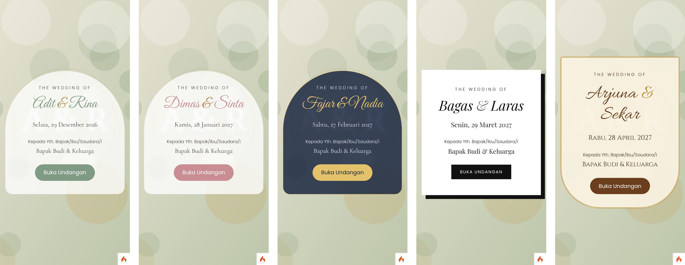
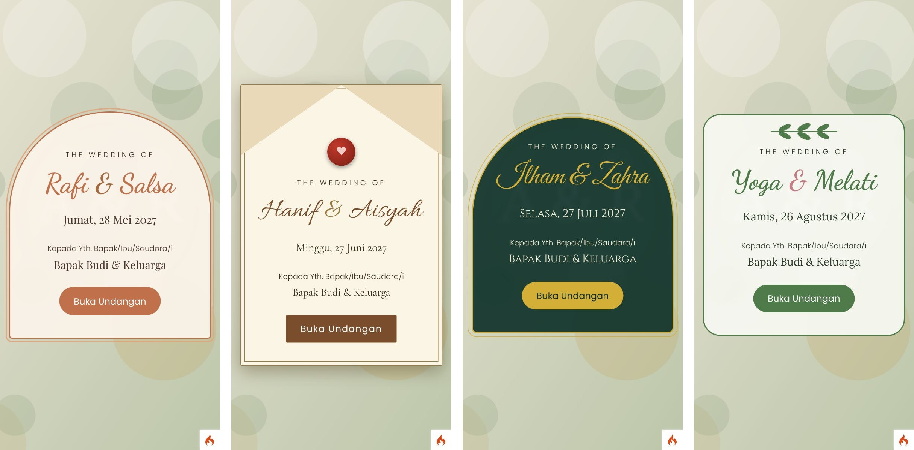

# Undangan Digital (CodeIgniter 4)

Website undangan pernikahan **multi-pasangan**: satu aplikasi, banyak undangan, masing-masing dengan link sendiri (`/u/{slug}`).

## Fitur
- Undangan publik responsif (HP-first): cover dengan nama tamu, mempelai, kutipan, hitung mundur, acara + peta, galeri, amplop digital (salin rekening), RSVP & buku ucapan, musik latar, tombol "Simpan ke Kalender".
- RSVP per acara (tamu memilih akad/resepsi), kuota orang per tamu, ekspor RSVP ke CSV, dan check-in tamu di hari-H.
- Live streaming (embed YouTube) dan titip kado (alamat pengiriman).
- Link personal per tamu: `/u/{slug}/{kode}` atau `/u/{slug}?to=Nama`; tombol kirim via WhatsApp.
- 9 template: Elegant Sage, Romantic Rose, Royal Navy (gelap), Modern Minimal, Adat Jawa, Boho Terracotta, Vintage Envelope (cover amplop), Emerald Gold (gelap, motif geometris), dan Garden Leaf. Dipilih per undangan di admin (kartu dengan tombol *Pratinjau*).
- Panel admin `/admin`: peran **admin** (semua undangan + kelola akun) dan **client** (hanya undangan miliknya).

## Tampilan



Halaman penuh per template: [Sage](docs/screenshots/sage-2-halaman-penuh.jpg) · [Rose](docs/screenshots/rose-2-halaman-penuh.jpg) · [Navy](docs/screenshots/navy-2-halaman-penuh.jpg) · [Minimal](docs/screenshots/minimal-2-halaman-penuh.jpg) · [Adat Jawa](docs/screenshots/javanese-2-halaman-penuh.jpg) · [Boho](docs/screenshots/boho-2-halaman-penuh.jpg) · [Vintage](docs/screenshots/vintage-2-halaman-penuh.jpg) · [Emerald](docs/screenshots/emerald-2-halaman-penuh.jpg) · [Garden](docs/screenshots/garden-2-halaman-penuh.jpg) · Admin: [daftar](docs/screenshots/admin-2-daftar.jpg), [kelola](docs/screenshots/admin-3-kelola.jpg)

## Pemasangan di Laragon (Windows)
Contoh folder: `D:\laragon\www\undangan`. Buka **Terminal** dari Laragon (agar PHP, Composer, dan Git sudah ada di PATH).
```bat
cd D:\laragon\www
git clone -b ccr-1a44af08-js655g https://github.com/irfalnafiyandi/undangan.git undangan
cd undangan
composer install
copy env .env
```
1. Aktifkan ekstensi **intl** dan **mbstring**: klik kanan ikon Laragon → *PHP* → *Extensions*, centang `intl` dan `mbstring`, lalu *Reload*.
2. Buat database: *Menu → Database → HeidiSQL* → buat database `undangan` (collation `utf8mb4_general_ci`).
3. Edit `.env`:
```ini
CI_ENVIRONMENT = development
app.baseURL = 'http://undangan.test/'

database.default.hostname = localhost
database.default.database = undangan
database.default.username = root
database.default.password =
database.default.DBDriver = MySQLi
```
4. Jalankan migrasi dan data contoh:
```bat
php spark migrate
php spark db:seed DemoSeeder
```
5. Buka `http://undangan.test` (Laragon *Auto Virtual Hosts*, klik *Reload* bila belum muncul). Document root harus mengarah ke folder **`public`**. Jika Laragon mengarah ke folder `undangan` (bukan `public`), ubah document root vhost ke `D:\laragon\www\undangan\public`, atau cukup jalankan `php spark serve` lalu buka `http://localhost:8080` (ubah `app.baseURL` sesuai).

Setelah `git pull` berikutnya, jalankan lagi `composer install` dan `php spark migrate`.

## Menjalankan
```bash
composer install
cp env .env            # lalu atur baseURL / database bila perlu
php spark migrate      # jalankan lagi setelah update untuk menerapkan migrasi baru
php spark db:seed DemoSeeder
php spark serve        # http://localhost:8080
```
Default database SQLite (`writable/database.sqlite`). Untuk MySQL, atur `database.default.*` di `.env`.

Akun demo (ganti sebelum produksi!): `admin@undangan.test` / `admin123`, `klien@undangan.test` / `klien123`.
Contoh undangan: `/u/rina-dan-adit`, `/u/dimas-dan-sinta`, `/u/fajar-dan-nadia`.

Produksi: set `CI_ENVIRONMENT = production`, arahkan document root ke folder `public/`, dan pastikan `public/uploads` dapat ditulis.

## Menambah / mengganti template
Template = satu blok CSS + satu entri daftar, tanpa mengubah view:
1. Tambah entri di `InvitationModel::TEMPLATES` (kunci, label, deskripsi, 3 warna swatch).
2. Tambah blok `body[data-theme=kunci-anda] { ... }` di `public/assets/css/invitation.css`. Atur variabel `--bg --alt --ink --accent --gold --card`, font (`--f-script --f-serif`), lalu override bentuk (cover, foto, kartu) sesuai selera. Lihat blok *Modern Minimal* sebagai contoh.
3. Jika memakai font baru, tambahkan di tag `<link>` Google Fonts pada `app/Views/invitation/show.php`.

Pratinjau tanpa menyimpan: buka `/u/{slug}?theme=kunci` saat sudah login admin.

## Aset dummy
Gambar di `public/assets/img/dummy/` adalah SVG placeholder. Musik `public/assets/audio/canon-demo.mp3` adalah aransemen sintetis sederhana progresi Canon in D (domain publik). Ganti lewat admin (kolom Musik) dengan lagu berlisensi yang Anda miliki.
